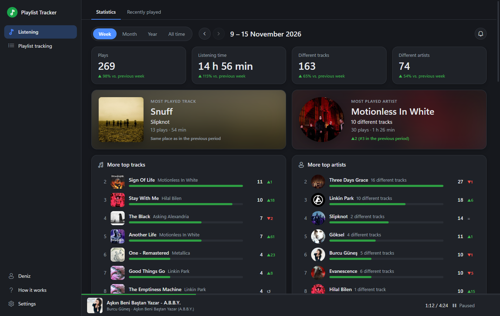
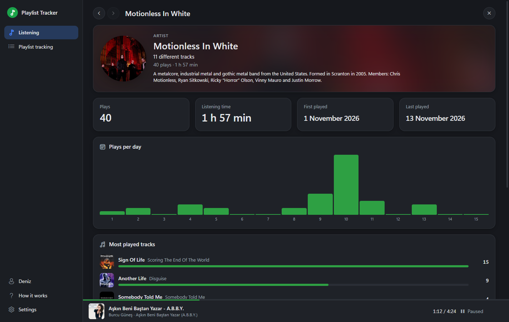
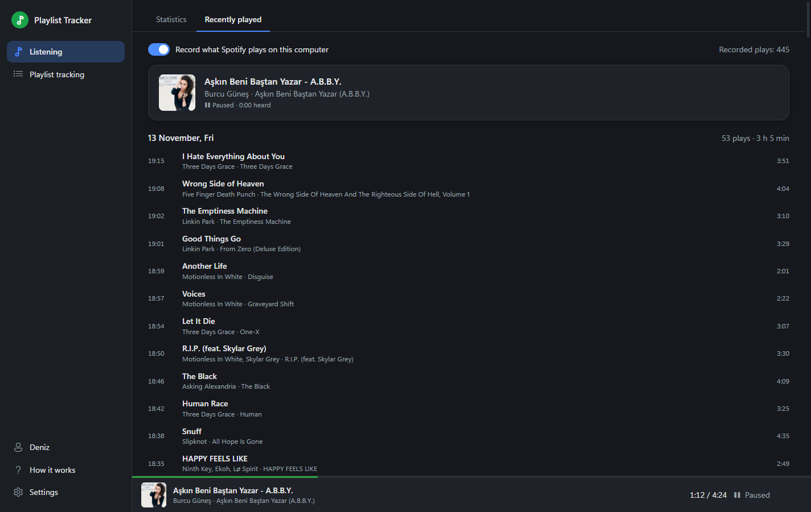
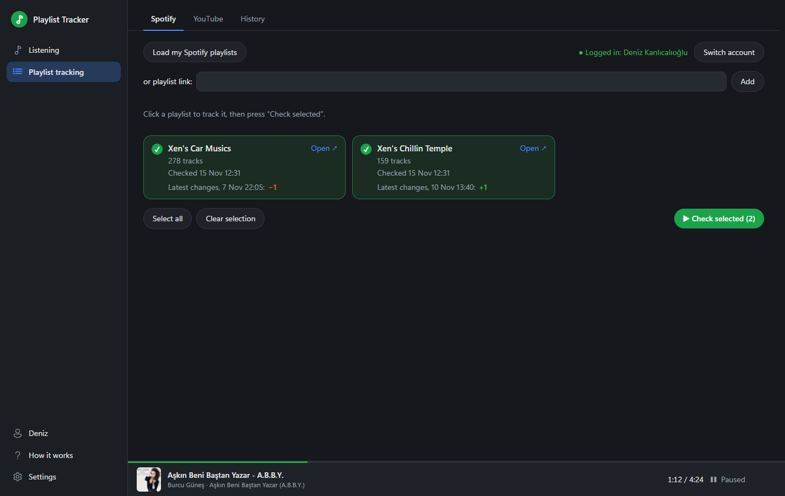
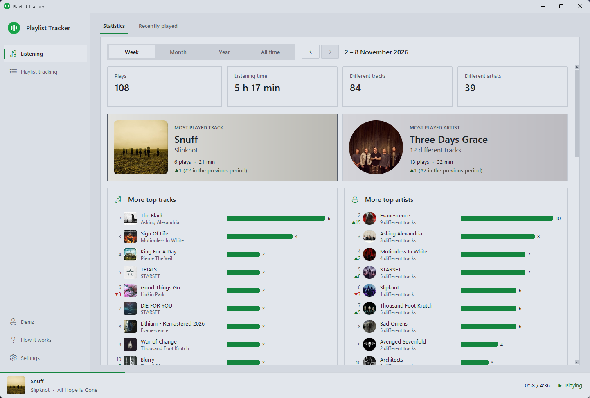
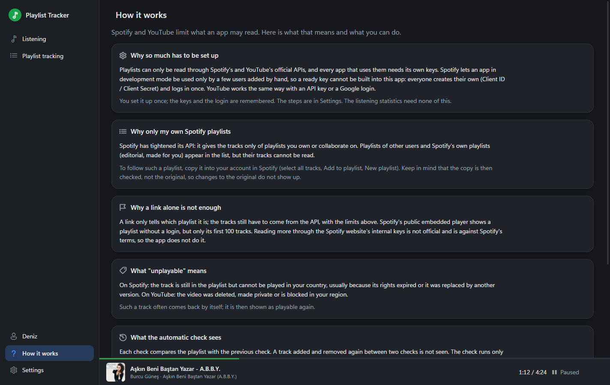

# Spotify Playlist Tracker



Are tracks silently disappearing from your Spotify playlists, or videos from your YouTube playlists? This app keeps
a history of your playlists: which track was **added when**, which one was **removed when**, and which one became
**unplayable**. Spotify and YouTube playlists are tracked side by side, each in its own tab and its own database.

Spotify does not record when a track leaves a playlist. On every check the app saves a snapshot of the playlist
and compares it with the previous one, so the title, artist and original add date of every vanished track stay on record.

## Screenshots

| | |
|---|---|
|  |  |
| **Artist page:** plays over time, most played tracks and a few words about the artist | **Recently played**, by day, with the song playing now and the mini player along the bottom |
|  |  |
| **Playlist tracking:** tracked playlists with their last check and latest changes | **Light theme**, or follow the Windows setting |
|  | |
| **How it works:** what Spotify and YouTube allow, and why | |

The screenshots are taken by the window itself: `PLAYLIST_TRACKER_SCREENSHOT=file.png npx electron .` in
`desktop/` saves the page a few seconds after it opens and quits (`PLAYLIST_TRACKER_SCREENSHOT_JS` runs in the page
first, e.g. to click a section).

## Features

- Log in with your Spotify account and load your playlists (including private ones) with one click
- Select the playlists you want to track
- A change report on every check:
  - **+ Added**: new tracks and when they were added
  - **− Removed**: tracks that disappeared, when they were added and when they were last seen
  - **! Unplayable**: tracks still in the playlist but no longer playable in your market (expired licenses are greyed out or hidden by Spotify; most "vanished" tracks are actually these)
  - **✓ Playable again**: tracks that became playable again
- **YouTube playlists** too: deleted, private or region-blocked videos are reported as unplayable, and their
  original title is kept even after YouTube replaces it with "Deleted video"
- **Automatic checks:** while the app runs (also in the tray) the tracked playlists are checked by themselves
  every 6, 12 or 24 hours, and removed or unplayable tracks are reported in a Windows notification
  (**Settings → General**)
- History view filterable by source (Spotify / YouTube), playlist and event type
- Export the history to a CSV file that opens in Excel
- **Listening history** in its own section, without the Spotify API: what the Spotify desktop app plays on
  this computer is recorded with the time actually listened, so your most played tracks and artists are
  counted from your own plays.
- **Listening statistics** per week, month, year or all time: your number one track and artist with album cover
  and artist photo, the rest of the top 10 with each one's move since the previous period (▲ ▼, NEW when heard for the first time, ↺ when back after a break), the tracks
  and artists you discovered in it, the share of each genre, listening time, plays per day or month and by hour of day, compared with the
  same stretch of the previous period, and (under all time) the tracks you used to play a lot but have not played
  for 30 days, and a 3×3 collage of the period's most played album covers (a cover opens the album's page).
  It also shows how varied the period was (the top five artists' share, different and new tracks, compared with
  the period before), how the share of your main genres changed over it, and the milestones you reached (your
  100th play, an artist's 25th play, the day you first heard a favorite) with the top tracks of a year earlier.
  Click a track or artist for its own page: first and last play, totals, plays over time and an
  artist's most played tracks; an album's page lists all its tracks with how often you played each.
  An artist's page also says in a sentence or two what kind of band or artist it is,
  where and when it started and who its members are (from MusicBrainz, no account needed). Pages open in the
  statistics, with back / forward buttons (Alt+← / Alt+→) and a close button (Esc).
- **Monthly summary:** a month in review, slide by slide: time listened, song and artist of the month, top
  fives, discoveries, busiest day and hour, genres and a closing overview. It is there on the 1st and 2nd of
  each month for the month before (in January for the year before too): it opens by itself once, a notification
  says it is ready, and until you open it it waits behind the bell of the statistics.
- **Mini player:** a strip along the bottom of the window shows the song playing in Spotify with its cover and
  progress; clicking it opens the song's page.
- **Runs in the background:** closing the window keeps the app in the system tray, where recording can be
  paused; it can also start with Windows. Only one copy runs at a time, opening it again shows the window.
- **Installer for Windows:** the app installs like any other program and needs no Python or Node on the computer.
- **Account and sync:** log in with Google to sync your plays and the playlists you track between your devices
  (through [Supabase](https://supabase.com)). "Remember me" opens the app straight away next time; everything
  also works without an account, and your data stays on your computer as the main copy.
- **How it works** page: what Spotify and YouTube let an app read, and what you can do about it
- English and Turkish interface, light and dark theme (or follow the Windows setting), under **Settings → General**
- The window is an [Electron](https://www.electronjs.org) app written in React and TypeScript (`desktop/`); the
  recording, checks, sync and statistics are Python (`playlist_tracker/`), which the window starts behind itself
  and talks to on `127.0.0.1`. The command line uses the same Python code.

## Requirements

- Windows (the listening history reads Windows' media controls; the command line also runs on macOS and Linux)
- To use the installer: nothing else. To build it or run from the code: [Python 3.9+](https://www.python.org/downloads/)
  (tick "Add Python to PATH") and [Node.js 22.12+](https://nodejs.org).
- A Spotify account. Spotify requires the account that creates a developer app to be **Premium**.

## Setup

### 1. Get the code

```
git clone https://github.com/Xendoksia/Spotify-Follow-Ur-List.git
```

or download it via **Code → Download ZIP** on GitHub and extract it.

### 2. Create a Spotify developer app (one time)

1. Log in at https://developer.spotify.com/dashboard with your Spotify account.
2. Click **Create app** and fill in the form:
   - **App name / description:** anything you like
   - **Redirect URI:** enter `http://127.0.0.1:8888/callback` and click **Add**. It must match exactly.
   - **Which API/SDKs:** tick **Web API**
3. Save, then copy the **Client ID** and **Client Secret** from the app's **Settings** page.

### 2b. Set up YouTube access (optional)

1. Open https://console.cloud.google.com, create a project and enable **YouTube Data API v3**.
2. **Credentials → Create credentials → API key.** This is enough for public and unlisted playlists.
3. Optional, for your private playlists and **Load my YouTube playlists**:
   - Configure the **OAuth consent screen** (External, testing mode) and add your Google account as a **test user**.
   - **Create credentials → OAuth client ID**, application type **Desktop app**. Copy the Client ID and Client Secret.
4. Enter the values in the app's **Settings → YouTube** tab.

If Google shows **`Error 403: access_denied`** when you log in, the account you chose is not on the test user list.
Go to **OAuth consent screen** (or **Google Auth Platform → Audience**) → **Test users** → **Add users**, add the
exact Gmail address you log in with and try again. You do not need to publish or verify the app. The
"Google hasn't verified this app" warning is expected: click **Continue** (under **Advanced** if hidden).

### 3. Install or run the app

Build the installer once and run it:

```
python -m pip install pyinstaller -r requirements.txt
cd desktop
npm install
npm run dist
```

This creates `desktop\release\Playlist Tracker Setup 1.0.0.exe`. It is not signed, so Windows asks whether to run
it: **More info → Run anyway**. The installed app keeps its data in `%APPDATA%\Playlist Tracker`. If an earlier
version of the app started with Windows, its settings, histories and pictures are copied there on the first start,
and the new app starts with Windows in its place.

To run it from the code instead, with its data in the repository folder:

```
python -m pip install -r requirements.txt
cd desktop
npm install
npm start
```

On first launch, enter your Client ID and Client Secret in **Settings → Spotify**. Then click **Log in with
Spotify** under **Playlist tracking** and approve access in the browser. You only need to do this once; the app remembers your session.

## Usage

1. Click **Load my Spotify playlists**.
2. Click each playlist you want to track; **Open ↗** opens it in Spotify.
3. Click **▶ Check selected**.
4. See the results in the **History** tab and optionally **Export CSV**.

YouTube works the same way in the **YouTube** tab. Without logging in with Google, add playlists by pasting their
link (`https://www.youtube.com/playlist?list=...`).

The first check of each playlist records an initial snapshot. Changes appear from the second check on.
The more often you check, the more precisely you know when a track was removed.

### Command line

```
python cli.py spotify login                                          # log in with Spotify
python cli.py spotify check https://open.spotify.com/playlist/...    # check a playlist
python cli.py spotify history                                        # print the history
python cli.py spotify export history.csv                             # export the history to CSV

python cli.py youtube login                                          # log in with Google (optional)
python cli.py youtube check https://www.youtube.com/playlist?list=...
python cli.py youtube history
python cli.py youtube export youtube_history.csv

python cli.py listening recent                                       # last recorded plays
python cli.py listening stats month                                  # most played this week/month/year/all
```

The command line uses the data in the repository folder. To use it without the window, copy
`config.example.json` to `config.json` and fill in your Client ID and Client Secret.

### Tests

```
python -m unittest
```

The tests use only the standard library and never touch your databases, `config.json` or any service.

### Configuration

| Key | Description |
|---|---|
| `CLIENT_ID` | Client ID of your Spotify developer app |
| `CLIENT_SECRET` | Client Secret of your Spotify developer app |
| `MARKET` | Country code used to check playability on Spotify and YouTube (optional, default `TR`) |
| `YOUTUBE_API_KEY` | Google API key with YouTube Data API v3 enabled |
| `YOUTUBE_CLIENT_ID` | Google OAuth client ID (Desktop app), optional |
| `YOUTUBE_CLIENT_SECRET` | Google OAuth client secret, optional |
| `LANGUAGE` | Interface language: `en` or `tr` (optional, default: system language) |
| `THEME` | `system`, `light` or `dark` (optional, default `system`) |
| `AUTO_CHECK` | Check tracked playlists automatically: `off`, `6h`, `12h` or `24h` (optional, default `24h`) |
| `SUPABASE_URL`, `SUPABASE_KEY` | Supabase project and its publishable key, for the account and sync (optional) |
| `CLOSE_TO_TRAY` | Keep running in the system tray when the window is closed (optional, default `true`) |

## Limitations

- **Your own playlists only:** under Spotify's 2026 API rules the app can only read tracks of playlists you
  **own or collaborate on**. Playlists of other users cannot be checked, even if you follow them.
- **Check frequency:** the app only checks when you run it. A removal is reported as having happened
  "between the previous check and this one".
- **Listening history:** only the Spotify desktop app on Windows is recorded, and only while this app is running
  (open or in the system tray).
  A song counts after 30 seconds of listening. Plays on other devices, such as your phone, are not recorded.
- **YouTube:** "Watch later" and automatic Mixes cannot be read through the API. The free API quota
  (10,000 units per day) is enough for thousands of checks. While your Google OAuth app is in testing mode,
  Google ends the session after 7 days and you need to log in again.
- **User limit:** in development mode, at most 5 users can log in to a Spotify app, so everyone should
  create their own Client ID.

## Data and privacy

All data stays on your computer: in `%APPDATA%\Playlist Tracker` for the installed app, in the repository folder
when it runs from the code:

| File | Contents |
|---|---|
| `config.json` | API keys, client secrets and sessions. **Do not share it.** |
| `history.db` | History of your Spotify playlists and changes (SQLite) |
| `youtube_history.db` | History of your YouTube playlists and changes (SQLite) |
| `listening.db` | Your recorded plays (SQLite) |
| `artwork/` | Cached album covers and artist photos |

All of them are listed in `.gitignore` and are never committed. The app connects only to Spotify and Google /
YouTube, plus Deezer's public search to find album covers that Windows did not provide, artist photos, and the
artists related to the ones you play most for the suggestions (only artist and track names and Deezer ids are sent,
no account is involved).

## Files

| File | Description |
|---|---|
| `desktop/` | The window: Electron (`electron/`: window, tray icon, starting the Python side) and React (`src/`) |
| `desktop/src/pages/` | Statistics and their pages, recently played, the summary, playlist tracking, account, settings |
| `cli.py` | Command line |
| `build.py` | Builds the Python side into a program of its own for the installer (PyInstaller) |
| `tests/` | Tests (`python -m unittest`) |
| `supabase/migrations/` | Tables of the sync, applied with `npx supabase db push` |
| `mobile/` | The phone app (Flutter) |
| `config.example.json` | Sample configuration file |
| `playlist_tracker/backend.py` | The Python side the window starts: recording, automatic checks, sync and the API |
| `playlist_tracker/api/` | The window's data and actions, served on `127.0.0.1` behind a token (`server.py`) |
| `playlist_tracker/background.py` | Single recording copy, the app's icon and starting with Windows |
| `playlist_tracker/migrate.py` | Copies an earlier version's data into the installed app's folder |
| `playlist_tracker/core/` | Settings (`config.py`), English and Turkish texts (`i18n.py`), account and sync, shared formats |
| `playlist_tracker/playlists/` | Spotify and YouTube clients, login redirect, playlist history and comparison (`history.py`) |
| `playlist_tracker/music/` | Listening history (`listening.py`), recording what Spotify plays (`nowplaying.py`), covers and artist photos (`artwork.py`), artist facts (`artist_info.py`), artists and tracks to discover (`recommend.py`), album collage, the summary's rules |
