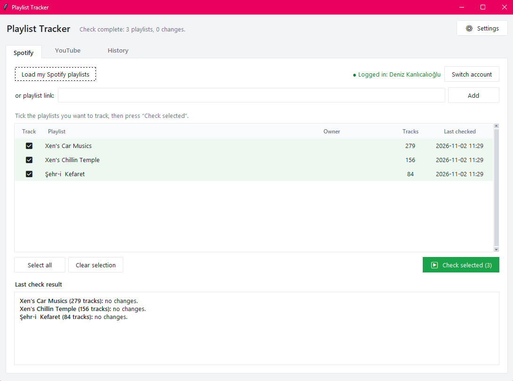

# Spotify Playlist Tracker



Are tracks silently disappearing from your Spotify playlists, or videos from your YouTube playlists? This app keeps
a history of your playlists: which track was **added when**, which one was **removed when**, and which one became
**unplayable**. Spotify and YouTube playlists are tracked side by side, each in its own tab and its own database.

Spotify does not record when a track leaves a playlist. On every check the app saves a snapshot of the playlist
and compares it with the previous one, so the title, artist and original add date of every vanished track stay on record.

## Features

- Log in with your Spotify account and load your playlists (including private ones) with one click
- Select the playlists you want to track
- A change report on every check:
  - **+ Added**: new tracks and when they were added
  - **− Removed**: tracks that disappeared, when they were added and when they were last seen
  - **! Unplayable**: tracks still in the playlist but no longer playable in your market (expired licenses are greyed out or hidden by Spotify; most "vanished" tracks are actually these)
  - **✓ Playable again**: tracks that became playable again
- **YouTube playlists** too: deleted, private or region-blocked videos are reported as unplayable, and their
  original title is kept even after YouTube replaces it with "Deleted video"
- History view filterable by source (Spotify / YouTube), playlist and event type
- Export the history to a CSV file that opens in Excel
- **Listening history** in its own section, without the Spotify API: what the Spotify desktop app plays on
  this computer is recorded with the time actually listened, so your most played tracks and artists are
  counted from your own plays.
- **Listening statistics** per week, month, year or all time: your number one track and artist with album cover
  and artist photo, the rest of the top 10 with each one's move since the previous period (▲ ▼ NEW), listening time, plays per day or month and by hour of day, compared
  with the same stretch of the previous period
- **Runs in the background:** closing the window keeps the app in the system tray, where recording can be
  paused; it can also start with Windows. Only one copy runs at a time, opening it again shows the window.
- English and Turkish interface, light and dark theme (or follow the Windows setting), under **Settings → General**
- Playlist tracking needs only the Python standard library. On Windows, `pip install -r requirements.txt` adds
  the tray icon, album covers, artist photos and the album and playback position of the playing song (without it the Spotify
  window title is used and the statistics show initials instead of pictures).

## Requirements

- Windows, macOS or Linux
- [Python 3.9+](https://www.python.org/downloads/). On Windows, tick "Add Python to PATH" during installation.
- A Spotify account. Spotify requires the account that creates a developer app to be **Premium**.

## Setup

### 1. Get the code

```
git clone https://github.com/Xendoksia/Spotify-Follow-Ur-List.git
```

or download it via **Code → Download ZIP** on GitHub and extract it.

### 2. Create a Spotify developer app (one time)

1. Log in at https://developer.spotify.com/dashboard with your Spotify account.
2. Click **Create app** and fill in the form:
   - **App name / description:** anything you like
   - **Redirect URI:** enter `http://127.0.0.1:8888/callback` and click **Add**. It must match exactly.
   - **Which API/SDKs:** tick **Web API**
3. Save, then copy the **Client ID** and **Client Secret** from the app's **Settings** page.

### 2b. Set up YouTube access (optional)

1. Open https://console.cloud.google.com, create a project and enable **YouTube Data API v3**.
2. **Credentials → Create credentials → API key.** This is enough for public and unlisted playlists.
3. Optional, for your private playlists and **Load my YouTube playlists**:
   - Configure the **OAuth consent screen** (External, testing mode) and add your Google account as a **test user**.
   - **Create credentials → OAuth client ID**, application type **Desktop app**. Copy the Client ID and Client Secret.
4. Enter the values in the app's **Settings → YouTube** tab.

If Google shows **`Error 403: access_denied`** when you log in, the account you chose is not on the test user list.
Go to **OAuth consent screen** (or **Google Auth Platform → Audience**) → **Test users** → **Add users**, add the
exact Gmail address you log in with and try again. You do not need to publish or verify the app. The
"Google hasn't verified this app" warning is expected: click **Continue** (under **Advanced** if hidden).

### 3. Run the app

```
python app.py
```

On Windows you can also double-click **`Spotify Playlist Tracker.bat`**.

#### Build a single .exe (Windows, optional)

```
python -m pip install pyinstaller -r requirements.txt
python build.py
```

This creates `dist\Spotify Playlist Tracker.exe`, which runs without Python. It keeps its settings and history
next to itself: to take your existing data along, copy `config.json` and the `.db` files into the same folder.

On first launch, enter your Client ID and Client Secret in the settings window. Then click **Log in with Spotify**
and approve access in the browser. You only need to do this once; the app remembers your session.

## Usage

1. Click **Load my Spotify playlists**.
2. Click the **☐** box of each playlist you want to track. Double-click a playlist to open it in Spotify.
3. Click **▶ Check selected**.
4. See the results in the **History** tab and optionally **Export CSV**.

YouTube works the same way in the **YouTube** tab. Without logging in with Google, add playlists by pasting their
link (`https://www.youtube.com/playlist?list=...`).

The first check of each playlist records an initial snapshot. Changes appear from the second check on.
The more often you check, the more precisely you know when a track was removed.

### Command line

```
python tracker.py login                                          # log in with Spotify
python tracker.py check https://open.spotify.com/playlist/...    # check a playlist
python tracker.py history                                        # print the history
python tracker.py export history.csv                             # export the history to CSV

python youtube.py login                                          # log in with Google (optional)
python youtube.py check https://www.youtube.com/playlist?list=...
python youtube.py history
python youtube.py export youtube_history.csv

python listening.py recent                                       # last recorded plays
python listening.py stats month                                  # most played this week/month/year/all
```

To use the command line without the GUI, copy `config.example.json` to `config.json` and fill in
your Client ID and Client Secret.

### Configuration

| Key | Description |
|---|---|
| `CLIENT_ID` | Client ID of your Spotify developer app |
| `CLIENT_SECRET` | Client Secret of your Spotify developer app |
| `MARKET` | Country code used to check playability on Spotify and YouTube (optional, default `TR`) |
| `YOUTUBE_API_KEY` | Google API key with YouTube Data API v3 enabled |
| `YOUTUBE_CLIENT_ID` | Google OAuth client ID (Desktop app), optional |
| `YOUTUBE_CLIENT_SECRET` | Google OAuth client secret, optional |
| `LANGUAGE` | Interface language: `en` or `tr` (optional, default: system language) |
| `THEME` | `system`, `light` or `dark` (optional, default `system`) |
| `CLOSE_TO_TRAY` | Keep running in the system tray when the window is closed (optional, default `true`) |

## Limitations

- **Your own playlists only:** under Spotify's 2026 API rules the app can only read tracks of playlists you
  **own or collaborate on**. Playlists of other users cannot be checked, even if you follow them.
- **Check frequency:** the app only checks when you run it. A removal is reported as having happened
  "between the previous check and this one".
- **Listening history:** only the Spotify desktop app on Windows is recorded, and only while this app is running
  (open or in the system tray).
  A song counts after 30 seconds of listening. Plays on other devices, such as your phone, are not recorded.
- **YouTube:** "Watch later" and automatic Mixes cannot be read through the API. The free API quota
  (10,000 units per day) is enough for thousands of checks. While your Google OAuth app is in testing mode,
  Google ends the session after 7 days and you need to log in again.
- **User limit:** in development mode, at most 5 users can log in to a Spotify app, so everyone should
  create their own Client ID.

## Data and privacy

All data stays on your computer, in the app folder:

| File | Contents |
|---|---|
| `config.json` | API keys, client secrets and sessions. **Do not share it.** |
| `history.db` | History of your Spotify playlists and changes (SQLite) |
| `youtube_history.db` | History of your YouTube playlists and changes (SQLite) |
| `listening.db` | Your recorded plays (SQLite) |
| `artwork/` | Cached album covers and artist photos |

All of them are listed in `.gitignore` and are never committed. The app connects only to Spotify and Google /
YouTube, plus Deezer's public search to find album covers that Windows did not provide and artist photos (only
the artist and track names are sent, no account is involved).

## Files

| File | Description |
|---|---|
| `app.py` | Graphical interface (tkinter) |
| `theme.py` | Light and dark color themes |
| `i18n.py` | English and Turkish interface texts |
| `tracker.py` | Spotify client, diff logic, database and command line |
| `youtube.py` | YouTube client and command line |
| `listening.py` | Listening history: storage, statistics and command line |
| `nowplaying.py` | Records what the Spotify desktop app plays, without the API |
| `listening_view.py` | Listening section of the interface |
| `stats_view.py` | Statistics tab of the Listening section |
| `background.py` | System tray icon, single running copy and starting with Windows |
| `charts.py` | Bar and column charts drawn with tkinter |
| `artwork.py` | Album covers and artist photos for the statistics |
| `build.py` | Builds the single-file Windows program with PyInstaller |
| `Spotify Playlist Tracker.bat` | Double-click launcher for Windows |
| `config.example.json` | Sample configuration file |
